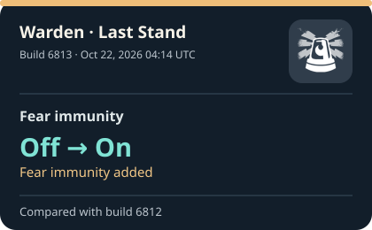
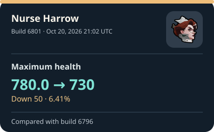
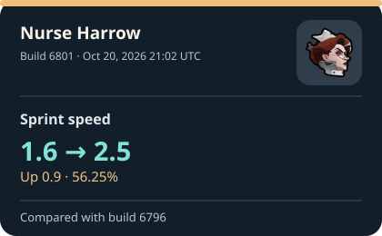
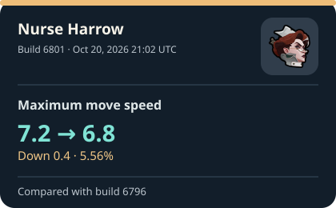
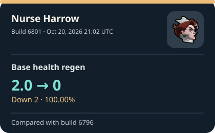

# Deadlock build tracker

See what changed in Deadlock. The latest update has a card and a short explanation. Five more cards show recent changes with a clear before and after. [Browse earlier builds](reports/index.md).

These are changes in extracted files. A value changing in a file does not, on its own, tell us how it felt or worked in a match.

**[Latest report](reports/latest.md) · [Recent changes](reports/recent-changes.md) · [Street Brawl](reports/street-brawl.md) · [Build history](reports/index.md)**

<!-- RECENT_CHANGES_START -->
## What changed in Deadlock?

Latest build found: [6819](reports/builds/6819.md) on Oct 22, 2026 at 23:53 UTC. Checks are scheduled every five minutes. [See when the tracker last checked](https://github.com/jordanbenjaminmitchell/deadlock-tracker/actions/workflows/track.yml).

### Latest update

Violet · Living Ink — Minimum stroke distance is now listed as **15.0**. There is no confirmed earlier value.

[See everything found in build 6819](reports/builds/6819.md).

### Five recent changes with a known before and after

Each card shows a value recorded in both builds. New settings are labeled separately because we cannot verify what their earlier value was.

<table>
<tr>
<td width="20%">

</td>
<td width="20%">

</td>
<td width="20%">

</td>
<td width="20%">

</td>
<td width="20%">

</td>
</tr>
</table>

### The changes in words

<ol>
<li><strong>Warden · Last Stand — Fear immunity</strong> Off → <strong>On</strong> Oct 22, 2026 04:14 UTC · Build 6813 (<a href="reports/infographics/recent/6813-1cd069c8b4a2.svg">view card</a>; <a href="reports/builds/6813.md">all changes</a>)</li>
<li><strong>Nurse Harrow — Maximum health</strong> 780.0 → <strong>730</strong> Oct 20, 2026 21:02 UTC · Build 6801 (<a href="reports/infographics/recent/6801-a4483b1c959f.svg">view card</a>; <a href="reports/builds/6801.md">all changes</a>)</li>
<li><strong>Nurse Harrow — Sprint speed</strong> 1.6 → <strong>2.5</strong> Oct 20, 2026 21:02 UTC · Build 6801 (<a href="reports/infographics/recent/6801-d6f27d6154ce.svg">view card</a>; <a href="reports/builds/6801.md">all changes</a>)</li>
<li><strong>Nurse Harrow — Maximum move speed</strong> 7.2 → <strong>6.8</strong> Oct 20, 2026 21:02 UTC · Build 6801 (<a href="reports/infographics/recent/6801-8039798a3b0c.svg">view card</a>; <a href="reports/builds/6801.md">all changes</a>)</li>
<li><strong>Nurse Harrow — Base health regen</strong> 2.0 → <strong>0</strong> Oct 20, 2026 21:02 UTC · Build 6801 (<a href="reports/infographics/recent/6801-f5e63356aa3f.svg">view card</a>; <a href="reports/builds/6801.md">all changes</a>)</li>
</ol>
<!-- RECENT_CHANGES_END -->

## How to read the changes

The tracker is scheduled to look for a new Deadlock build every five minutes. GitHub may start a scheduled check late. The page changes when [SteamTracking](https://github.com/SteamTracking/GameTracking-Deadlock) records a newer build. [See the latest check](https://github.com/jordanbenjaminmitchell/deadlock-tracker/actions/workflows/track.yml). A new setting is shown without a guessed old number. Every build report links to its source data.

Names come from the game data; some may be development labels. Each report links to the SteamTracking commit it came from. Open **Check the exact source values** in a report if you want the original data behind the plain-language text. The tracker covers selected game data, so a build can still contain changes outside these reports.

The icons on hero and ability cards are [actual Deadlock artwork](assets/icons/SOURCES.md). If matching art is unavailable, the card shows the change without an image.

## Examples from the archive

- [Street Brawl, build 6794](reports/builds/6794.md): the fifth buy-time value changed **65 → 50**, a decrease of 15.
- [Violet's Living Ink, build 6819](reports/builds/6819.md): **15.0** first appeared as a minimum stroke-distance setting. [The source investigation](docs/source-investigation-6819.md) explains why no earlier number can be verified.

[How the tracker works and how to run it](docs/technical.md)
