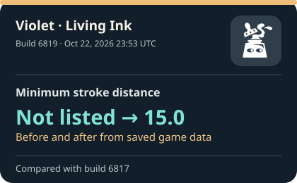
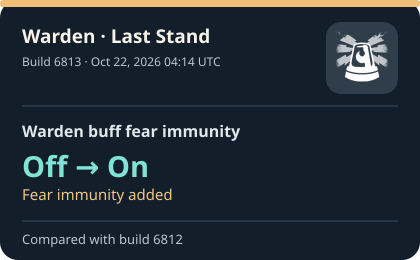
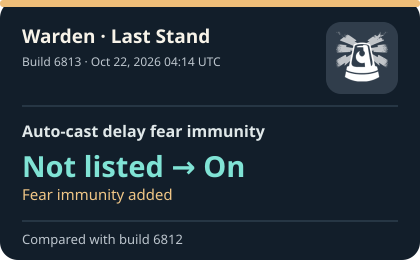
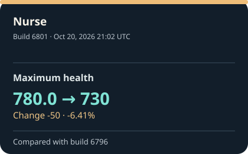
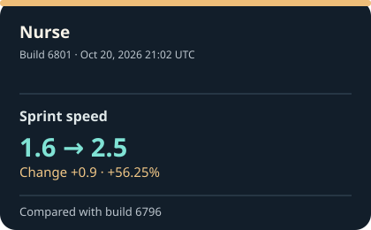

# Deadlock build tracker

See what changed between Deadlock builds with clear before and after values. This tracker reads public game data from [SteamTracking](https://github.com/SteamTracking/GameTracking-Deadlock) and saves a report for every build it finds. The cards below show the five most recent readable changes; the [build history](reports/index.md) has the full archive.

These are changes in extracted files. A value changing in a file does not, on its own, tell us how it felt or worked in a match.

**[Latest report](reports/latest.md) · [Recent changes](reports/recent-changes.md) · [Street Brawl](reports/street-brawl.md) · [Build history](reports/index.md)**

<!-- RECENT_CHANGES_START -->
## The latest five readable changes

Each card shows one value before and after the update. The date is when SteamTracking recorded that build (UTC). Changes within one build share the same recorded time; we show measured value changes first. ‘Not listed’ means the previous saved build had no value for that field.

<table>
<tr>
<td width="20%">

</td>
<td width="20%">

</td>
<td width="20%">

</td>
<td width="20%">

</td>
<td width="20%">

</td>
</tr>
</table>

### What changed, and when

<ol>
<li><strong>Violet · Living Ink — Minimum stroke distance</strong> Not listed → <strong>15.0</strong> Recorded Oct 22, 2026 23:53 UTC · Build 6819 (<a href="reports/infographics/recent/6819-cb87fa233b87.svg">view card</a>; <a href="reports/builds/6819.md">all changes</a>)</li>
<li><strong>Warden · Last Stand — Warden buff fear immunity</strong> Off → <strong>On</strong> (Fear immunity added) Recorded Oct 22, 2026 04:14 UTC · Build 6813 (<a href="reports/infographics/recent/6813-90745cfc9dc1.svg">view card</a>; <a href="reports/builds/6813.md">all changes</a>)</li>
<li><strong>Warden · Last Stand — Auto-cast delay fear immunity</strong> Not listed → <strong>On</strong> (Fear immunity added) Recorded Oct 22, 2026 04:14 UTC · Build 6813 (<a href="reports/infographics/recent/6813-3f30db0e057e.svg">view card</a>; <a href="reports/builds/6813.md">all changes</a>)</li>
<li><strong>Nurse — Maximum health</strong> 780.0 → <strong>730</strong> (Change -50 · -6.41%) Recorded Oct 20, 2026 21:02 UTC · Build 6801 (<a href="reports/infographics/recent/6801-3d18972fbcd5.svg">view card</a>; <a href="reports/builds/6801.md">all changes</a>)</li>
<li><strong>Nurse — Sprint speed</strong> 1.6 → <strong>2.5</strong> (Change +0.9 · +56.25%) Recorded Oct 20, 2026 21:02 UTC · Build 6801 (<a href="reports/infographics/recent/6801-71d2fbfa29f4.svg">view card</a>; <a href="reports/builds/6801.md">all changes</a>)</li>
</ol>
<!-- RECENT_CHANGES_END -->

## How to read the changes

About once an hour, this tracker checks for a new Deadlock build. It compares each tracked value with the previous saved build. Cards and readable report entries show the earlier value first, then the new value. Every report also links to a complete before and after download for complex data. **Not listed** means the earlier build had no value for that field; it does not mean zero. A card highlights one change from a build, and its report has the rest.

Names come from the game data; some may be development labels. Each report links to the SteamTracking commit it came from. Open **Check the exact source values** in a report if you want the original data behind the plain-language text. The tracker covers selected game data, so a build can still contain changes outside these reports.

The icons on ability cards are [actual Deadlock ability artwork](assets/icons/SOURCES.md). If a matching icon is unavailable, the card shows the change without one.

## Examples from the archive

- [Street Brawl, build 6794](reports/builds/6794.md): the fifth buy-time value changed **65 → 50**, a decrease of 15.
- [Violet's Living Ink, build 6819](reports/builds/6819.md): minimum stroke distance was **not listed → 15.0**. The earlier build had no value for that field, so there is no measured increase to claim.

[How the tracker works and how to run it](docs/technical.md)
