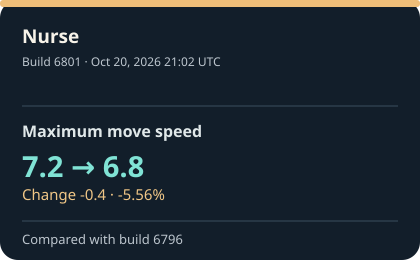
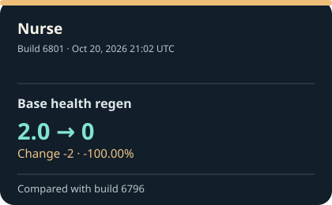

# Deadlock build tracker

See what changed between Deadlock builds with clear before and after values. This tracker reads public game data from [SteamTracking](https://github.com/SteamTracking/GameTracking-Deadlock) and saves a report for every build it finds. The cards below show the five most recent changes with verified earlier and new values; the [build history](reports/index.md) has the full archive.

These are changes in extracted files. A value changing in a file does not, on its own, tell us how it felt or worked in a match.

**[Latest report](reports/latest.md) · [Recent changes](reports/recent-changes.md) · [Street Brawl](reports/street-brawl.md) · [Build history](reports/index.md)**

<!-- RECENT_CHANGES_START -->
## The latest five verified comparisons

Latest archived build: [6819](reports/builds/6819.md), recorded Oct 22, 2026 23:53 UTC. This page changes when SteamTracking records a newer client build; [check the latest scheduled run](https://github.com/jordanbenjaminmitchell/deadlock-tracker/actions/workflows/track.yml).

Each card uses a field recorded in both saved builds, with its earlier and new value. The date is when SteamTracking recorded the newer build (UTC). Newly introduced settings appear in their build reports without an invented previous value.

<table>
<tr>
<td width="20%">

</td>
<td width="20%">

</td>
<td width="20%">

</td>
<td width="20%">

</td>
<td width="20%">

</td>
</tr>
</table>

### What changed, and when

<ol>
<li><strong>Warden · Last Stand — Warden buff fear immunity</strong> Off → <strong>On</strong> (Fear immunity added) Recorded Oct 22, 2026 04:14 UTC · Build 6813 (<a href="reports/infographics/recent/6813-90745cfc9dc1.svg">view card</a>; <a href="reports/builds/6813.md">all changes</a>)</li>
<li><strong>Nurse — Maximum health</strong> 780.0 → <strong>730</strong> (Change -50 · -6.41%) Recorded Oct 20, 2026 21:02 UTC · Build 6801 (<a href="reports/infographics/recent/6801-3d18972fbcd5.svg">view card</a>; <a href="reports/builds/6801.md">all changes</a>)</li>
<li><strong>Nurse — Sprint speed</strong> 1.6 → <strong>2.5</strong> (Change +0.9 · +56.25%) Recorded Oct 20, 2026 21:02 UTC · Build 6801 (<a href="reports/infographics/recent/6801-71d2fbfa29f4.svg">view card</a>; <a href="reports/builds/6801.md">all changes</a>)</li>
<li><strong>Nurse — Maximum move speed</strong> 7.2 → <strong>6.8</strong> (Change -0.4 · -5.56%) Recorded Oct 20, 2026 21:02 UTC · Build 6801 (<a href="reports/infographics/recent/6801-85c7f54998c0.svg">view card</a>; <a href="reports/builds/6801.md">all changes</a>)</li>
<li><strong>Nurse — Base health regen</strong> 2.0 → <strong>0</strong> (Change -2 · -100.00%) Recorded Oct 20, 2026 21:02 UTC · Build 6801 (<a href="reports/infographics/recent/6801-fab0192d04aa.svg">view card</a>; <a href="reports/builds/6801.md">all changes</a>)</li>
</ol>
<!-- RECENT_CHANGES_END -->

## How to read the changes

The tracker is scheduled to check for new Deadlock builds every hour. The page changes when SteamTracking records a newer client build. [See the latest check](https://github.com/jordanbenjaminmitchell/deadlock-tracker/actions/workflows/track.yml). The five comparison cards show values present in both saved builds. A new setting is described separately because its earlier in-game behavior cannot be verified from these files. Every build report links to the exact source data.

Names come from the game data; some may be development labels. Each report links to the SteamTracking commit it came from. Open **Check the exact source values** in a report if you want the original data behind the plain-language text. The tracker covers selected game data, so a build can still contain changes outside these reports.

The icons on ability cards are [actual Deadlock ability artwork](assets/icons/SOURCES.md). If a matching icon is unavailable, the card shows the change without one.

## Examples from the archive

- [Street Brawl, build 6794](reports/builds/6794.md): the fifth buy-time value changed **65 → 50**, a decrease of 15.
- [Violet's Living Ink, build 6819](reports/builds/6819.md): **15.0** first appeared as a minimum stroke-distance setting. [The source investigation](docs/source-investigation-6819.md) explains why no earlier number can be verified.

[How the tracker works and how to run it](docs/technical.md)
