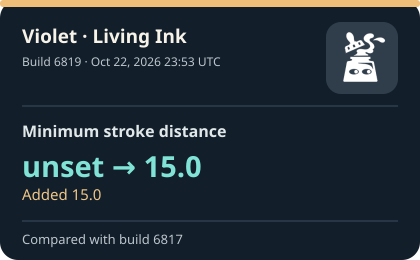
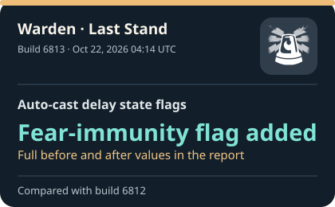
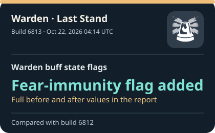
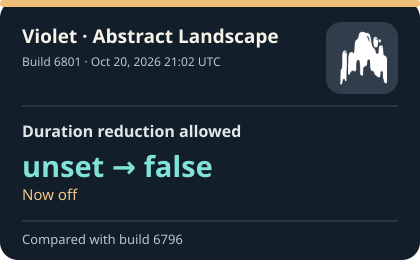
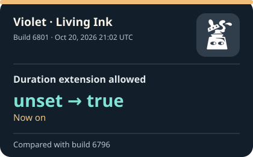

# Deadlock build tracker

See what changed between Deadlock builds, with the exact before and after values beside each change. This tracker reads public game data from [SteamTracking](https://github.com/SteamTracking/GameTracking-Deadlock) and saves a report for every build it finds. The cards below show the five most recent individual changes; the [build history](reports/index.md) has the full archive.

These are changes in extracted files. A value changing in a file does not, on its own, tell us how it felt or worked in a match.


**[Latest report](reports/latest.md) · [Recent changes](reports/recent-changes.md) · [Street Brawl](reports/street-brawl.md) · [Build history](reports/index.md)**

<!-- RECENT_CHANGES_START -->
## The latest five changes

Here are the five most recent individual values we found changing in the game data we track. The time on each card is when SteamTracking recorded the build (UTC). Values use the source's units; we do not guess at missing units. Open a build report to see every change in that build.

<table>
<tr>
<td width="20%">
<a href="reports/infographics/recent/6819-7c3bc775ffd6.svg"></a>
</td>
<td width="20%">
<a href="reports/infographics/recent/6813-4ac8e64d4b98.svg"></a>
</td>
<td width="20%">
<a href="reports/infographics/recent/6813-31c66ad54ffe.svg"></a>
</td>
<td width="20%">
<a href="reports/infographics/recent/6801-3875ea06f36b.svg"></a>
</td>
<td width="20%">
<a href="reports/infographics/recent/6801-645c36996f46.svg"></a>
</td>
</tr>
</table>

### What changed, and when

<ol>
<li><strong>Violet · Living Ink — Minimum stroke distance: Added 15.0</strong><br>Build 6819 · Oct 22, 2026 23:53 UTC (<a href="reports/infographics/recent/6819-7c3bc775ffd6.svg">view card</a>; <a href="reports/builds/6819.md">all changes</a>; <a href="https://github.com/SteamTracking/GameTracking-Deadlock/commit/17462b250a0ca80e7f80102f2c83cc3eecff5f12">source commit</a>)<br><code>unset</code> → <code>15.0</code> · Source field: <code>abilities.ability_artist_pullbrush.m_flMinStrokeDistance</code></li>
<li><strong>Warden · Last Stand — Auto-cast delay state flags: Fear-immunity flag added</strong><br>Build 6813 · Oct 22, 2026 04:14 UTC (<a href="reports/infographics/recent/6813-4ac8e64d4b98.svg">view card</a>; <a href="reports/builds/6813.md">all changes</a>; <a href="https://github.com/SteamTracking/GameTracking-Deadlock/commit/a94d8b455203f12b176de75a5598dd8e6e8a94d4">source commit</a>)<br><code>unset</code> → <code>&quot;MODIFIER_STATE_FEAR_IMMUNE&quot;</code> · Source field: <code>abilities.ability_warden_riot_protocol.m_AutoCastDelayModifier.m_nEnabledStateMask</code></li>
<li><strong>Warden · Last Stand — Warden buff state flags: Fear-immunity flag added</strong><br>Build 6813 · Oct 22, 2026 04:14 UTC (<a href="reports/infographics/recent/6813-31c66ad54ffe.svg">view card</a>; <a href="reports/builds/6813.md">all changes</a>; <a href="https://github.com/SteamTracking/GameTracking-Deadlock/commit/a94d8b455203f12b176de75a5598dd8e6e8a94d4">source commit</a>)<br><code>&quot;MODIFIER_STATE_SINCLAIR_TAX_ULT_ACTIVE | MODIFIER_STATE_SINCLAIR_TAX_KEEP_MODEL_SWAP&quot;</code> → <code>&quot;MODIFIER_STATE_SINCLAIR_TAX_ULT_ACTIVE | MODIFIER_STATE_SINCLAIR_TAX_KEEP_MODEL_SWAP | MODIFIER_STATE_FEAR_IMMUNE&quot;</code> · Source field: <code>abilities.ability_warden_riot_protocol.m_WardenBuffModifier.m_nEnabledStateMask</code></li>
<li><strong>Violet · Abstract Landscape — Duration reduction allowed: Now off</strong><br>Build 6801 · Oct 20, 2026 21:02 UTC (<a href="reports/infographics/recent/6801-3875ea06f36b.svg">view card</a>; <a href="reports/builds/6801.md">all changes</a>; <a href="https://github.com/SteamTracking/GameTracking-Deadlock/commit/37f9aebdc62766aa13748f73309b9b8120549833">source commit</a>)<br><code>unset</code> → <code>false</code> · Source field: <code>abilities.ability_artist_bamboogrove.m_BambooModifier.m_ImmuneModifier.m_bDurationReducible</code></li>
<li><strong>Violet · Living Ink — Duration extension allowed: Now on</strong><br>Build 6801 · Oct 20, 2026 21:02 UTC (<a href="reports/infographics/recent/6801-645c36996f46.svg">view card</a>; <a href="reports/builds/6801.md">all changes</a>; <a href="https://github.com/SteamTracking/GameTracking-Deadlock/commit/37f9aebdc62766aa13748f73309b9b8120549833">source commit</a>)<br><code>unset</code> → <code>true</code> · Source field: <code>abilities.ability_artist_homingbrush.m_StackModifier.m_bDurationExtendible</code></li>
</ol>
<!-- RECENT_CHANGES_END -->

## How the tracker works

Every three hours, the [GitHub Actions workflow](.github/workflows/track.yml) checks SteamTracking for new Deadlock client builds. It confirms the build number in `steam.inf`, compares six extracted game data files with the previous archived build, and writes a report and a single-change card. If a build has more than one change, its card shows one example and links to the complete report. You can also run it manually. If there is no new build, it leaves the archive alone.

The reports show before and after values, including the numerical difference and percentage where those make sense. Each one links back to the source commit and files. Cards use [Deadlock ability icons](assets/icons/SOURCES.md) matched to the image path in the archived game data. The workflow saves newly needed icons automatically; if an icon is unavailable, the card stays text-only. Snapshots live in `data/builds/`, and identical file content is stored once in `data/blobs/`. A game data download or parsing failure stops the run before it saves a partial build.

### Local commands

Python 3.12+ and the standard library are sufficient.

```sh
python -m unittest discover -s tests -v
python src/tracker.py
python src/compare_builds.py 6793 6794
python src/compare_builds.py 6793 6819 --json
```

The comparison command uses saved snapshots, so it also works offline. To rebuild the public reports and graphics from the archive after a copy change, run `python src/tracker.py --refresh-presentation`. This archive starts at build 6793. To collect earlier history, lower `FIRST_BUILD` in `src/tracker.py` and run the tracker in a fresh archive.

## Where the information comes from

| Source | How we use it |
|---|---|
| [SteamTracking GameTracking-Deadlock](https://github.com/SteamTracking/GameTracking-Deadlock) | The source for every report. We read its extracted VData and confirm the client build in `steam.inf`. This is public extracted data, not an official Valve API. |
| [SteamDB Deadlock history](https://steamdb.info/app/1422450/history/) | A reference for Steam app and depot history. The tracker does not pull data from it. |
| [Frogtech changelog](https://changelog.frogtech.dev/) | Useful context for file and map changes. Its interpretations are not substituted for source values. |
| [Deadlock Data API](https://deadlock-data-api.iainfox.dev/docs) | A separate, nightly hero and item reference. Its version IDs and timing differ from client builds, so we do not merge its data into reports. |
| [unDeadlock](https://undeadlock.com/), [deadlock.io](https://deadlock.io/api/v1/index.json), and [Deadlock Almanac](https://deadlock.ing/) | Extra references for research. The tracker does not import their interpretations. |
| [r/DeadlockTheGame](https://www.reddit.com/r/DeadlockTheGame/) | Sometimes provides a discussion for an exact build. Any such link is optional context, not proof of a data change. |

The tracker reads `abilities.vdata`, `generic_data.vdata`, `heroes.vdata`, `misc.vdata`, `modifiers.vdata`, and `npc_units.vdata`. Those files contain Street Brawl settings, heroes, abilities, items, NPCs, and other values. The tracker does not archive map geometry, executable code, assets, localization, or VData files outside that group. A report with zero tracked changes does not mean the whole game stayed the same.

The code in this repository is offered under the MIT license. Game data and game artwork remain the property of their respective owners; this repository does not grant rights to those materials. Reports cite the source commit and each extracted file.

## A couple of changes in the archive

- [Street Brawl, build 6794](reports/builds/6794.md): the fifth buy-time value changed **65 → 50** (−15, or −23.08%). [Check the source commit](https://github.com/SteamTracking/GameTracking-Deadlock/commit/df1192043fd269aee7edf4dffdfb4cfc03d05f64).
- [Violet's Living Ink, build 6819](reports/builds/6819.md): a minimum stroke distance value of **15.0** appeared in the file. There was no earlier value in the tracked field, so this is an addition, not a measured increase.

## If updates stop

Check the workflow's **Read and write permissions** if GitHub does not let it save new reports. A GitHub rate limit, a missing upstream file, or a parsing error can also pause updates. If an upstream commit for an archived build changes, the tracker stops and asks for investigation instead of quietly replacing the old snapshot.
