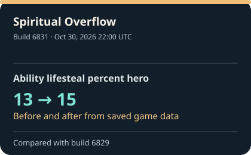

# Deadlock build tracker

See what changed in Deadlock, one update at a time. Each build has a short explanation, a change card, and exact before-and-after values when both are known. [Find a character or mode in the build history](reports/index.md).

These are changes in extracted files. A value changing in a file does not, on its own, tell us how it felt or worked in a match.

**[Recent updates](reports/recent-changes.md) · [Browse by character or mode](reports/index.md) · [Latest report](reports/latest.md) · [Street Brawl](reports/street-brawl.md)**

<!-- RECENT_CHANGES_START -->
## What changed in Deadlock?

**Latest build recorded:** [6833](reports/builds/6833.md) on Oct 30, 2026 at 22:20 UTC.

**Tracker check:** Scheduled every five minutes. [See the most recent check and its time](https://github.com/jordanbenjaminmitchell/deadlock-tracker/actions/workflows/track.yml). GitHub may start a check late.

**History covered:** Oct 25, 2025–Oct 30, 2026 across 392 saved builds. [Browse by month](reports/index.md#updates-by-month).

### Latest update

Baba bench melee — Cooldown on miss changed from **1.6** to **1.5**.

[See everything found in build 6833](reports/builds/6833.md) · [Check the source](https://github.com/SteamTracking/GameTracking-Deadlock/commit/b18c406df07927fc6041d5d010241e7e88b8323b).

### Previous updates

#### Build 6831 · Oct 30, 2026 22:00 UTC

Spiritual Overflow — Ability lifesteal percent hero changed from **13** to **15**.

- **Spiritual Overflow — Ability lifesteal percent hero**: 13 → **15**

[See all changes in build 6831](reports/builds/6831.md) · [Check the source](https://github.com/SteamTracking/GameTracking-Deadlock/commit/f6be4e77c8be192a904a22de58adf3e66a26104f).

#### Build 6827 · Oct 30, 2026 21:05 UTC

This build changed data without a simple value to highlight.

[See all changes in build 6827](reports/builds/6827.md) · [Check the source](https://github.com/SteamTracking/GameTracking-Deadlock/commit/319b4b8a190e78c66bc80d75997ee909433a73d3).

#### Build 6826 · Oct 30, 2026 20:54 UTC

Graves — Maximum move speed changed from **7.0** to **6.7**.

Key values in this update:

- **Graves — Maximum move speed**: 7.0 → **6.7** (Down 0.3 · 4.29%)
- **Silver — Base health regen**: 2.5 → **3** (Up 0.5 · 20.00%)
- **Solomon — Crit damage bonus scale**: 1.0 → **0.8** (Down 0.2 · 20.00%)
- **Violet · Abstract Landscape — Immune duration**: 0.5 → **0.75** (Up 0.25 · 50.00%)
- **Violet · Still Life — Buildup grace period**: 0.3 → **0.45** (Up 0.15 · 50.00%)

[See all changes in build 6826](reports/builds/6826.md) · [Check the source](https://github.com/SteamTracking/GameTracking-Deadlock/commit/fd21313e755aaac0a1625e0851b8d5c3f03ff46d).

#### Build 6821 · Oct 26, 2026 20:03 UTC

This build changed data without a simple value to highlight.

[See all changes in build 6821](reports/builds/6821.md) · [Check the source](https://github.com/SteamTracking/GameTracking-Deadlock/commit/d251cf9d9a796061c90f58724230b7e17b97121b).

Last five changes with a verified before and after

These are individual values, so several can come from one build.

- **Baba bench melee — Cooldown on miss**: 1.6 → **1.5** (Down 0.1 · 6.25%) · Oct 30, 2026 22:20 UTC · Build 6833 ([card](reports/infographics/recent/6833-92649cebfee9.svg); [full update](reports/builds/6833.md))
- **Spiritual Overflow — Ability lifesteal percent hero**: 13 → **15** · Oct 30, 2026 22:00 UTC · Build 6831 ([card](reports/infographics/recent/6831-7cc198ac25c7.svg); [full update](reports/builds/6831.md))
- **Graves — Maximum move speed**: 7.0 → **6.7** (Down 0.3 · 4.29%) · Oct 30, 2026 20:54 UTC · Build 6826 ([card](reports/infographics/recent/6826-69584e8a99e9.svg); [full update](reports/builds/6826.md))
- **Silver — Base health regen**: 2.5 → **3** (Up 0.5 · 20.00%) · Oct 30, 2026 20:54 UTC · Build 6826 ([card](reports/infographics/recent/6826-3aa2124330ab.svg); [full update](reports/builds/6826.md))
- **Solomon — Crit damage bonus scale**: 1.0 → **0.8** (Down 0.2 · 20.00%) · Oct 30, 2026 20:54 UTC · Build 6826 ([card](reports/infographics/recent/6826-708b0c701052.svg); [full update](reports/builds/6826.md))

<!-- RECENT_CHANGES_END -->

## How to read the changes

The tracker is scheduled to look for a new Deadlock build every five minutes. GitHub may start a scheduled check late. The page changes when [SteamTracking](https://github.com/SteamTracking/GameTracking-Deadlock) records a newer build. [See the latest check](https://github.com/jordanbenjaminmitchell/deadlock-tracker/actions/workflows/track.yml). A new setting is shown without a guessed old number. Every build report links to its source data.

Names come from the game data; some may be development labels. Each report links to the SteamTracking commit it came from. Open **Check the exact source values** in a report if you want the original data behind the plain-language text. The tracker covers selected game data, so a build can still contain changes outside these reports.

The icons on hero and ability cards are [actual Deadlock artwork](assets/icons/SOURCES.md). If matching art is unavailable, the card shows the change without an image.

## Examples from the archive

- [Street Brawl, build 6794](reports/builds/6794.md): the fifth buy-time value changed **65 → 50**, a decrease of 15.
- [Violet's Living Ink, build 6819](reports/builds/6819.md): **15.0** first appeared as a minimum stroke-distance setting. [The source investigation](docs/source-investigation-6819.md) explains why no earlier number can be verified.

[How the tracker works and how to run it](docs/technical.md)
