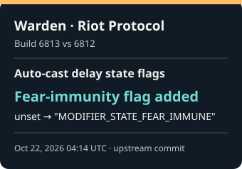
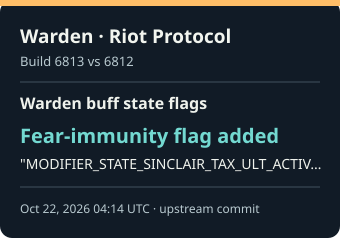
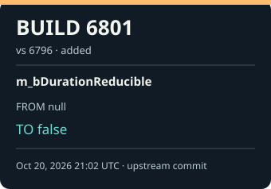
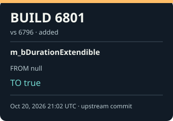

## Latest verified field changes

Five most recent scalar changes in tracked VData. Times are upstream commit timestamps in UTC; changes within one build share a timestamp and are ordered by field path. Each build report contains its full set of changes.

<table>
<tr>
<td width="20%" valign="top">
 
<strong><a href="builds/6819.md">Build 6819</a></strong> 
<small>Oct 22, 2026 23:53 UTC · <a href="https://github.com/SteamTracking/GameTracking-Deadlock/commit/17462b250a0ca80e7f80102f2c83cc3eecff5f12">upstream commit</a></small> 
<code>abilities.ability_artist_pullbrush.m_flMinStrokeDistance</code> 
<code>null</code> → <code>15.0</code> (added)
</td>
<td width="20%" valign="top">
 
<strong><a href="builds/6813.md">Build 6813</a></strong> 
<small>Oct 22, 2026 04:14 UTC · <a href="https://github.com/SteamTracking/GameTracking-Deadlock/commit/a94d8b455203f12b176de75a5598dd8e6e8a94d4">upstream commit</a></small> 
<code>abilities.ability_warden_riot_protocol.m_AutoCastDelayModifier.m_nEnabledStateMask</code> 
<code>null</code> → <code>&quot;MODIFIER_STATE_FEAR_IMMUNE&quot;</code> (added)
</td>
<td width="20%" valign="top">
 
<strong><a href="builds/6813.md">Build 6813</a></strong> 
<small>Oct 22, 2026 04:14 UTC · <a href="https://github.com/SteamTracking/GameTracking-Deadlock/commit/a94d8b455203f12b176de75a5598dd8e6e8a94d4">upstream commit</a></small> 
<code>abilities.ability_warden_riot_protocol.m_WardenBuffModifier.m_nEnabledStateMask</code> 
<code>&quot;MODIFIER_STATE_SINCLAIR_TAX_ULT_ACTIVE | MODIFIER_STATE_SINCLAIR_TAX_KEEP_MODEL_SWAP&quot;</code> → <code>&quot;MODIFIER_STATE_SINCLAIR_TAX_ULT_ACTIVE | MODIFIER_STATE_SINCLAIR_TAX_KEEP_MODEL_SWAP | MODIFIER_STATE_FEAR_IMMUNE&quot;</code> (changed)
</td>
<td width="20%" valign="top">
 
<strong><a href="builds/6801.md">Build 6801</a></strong> 
<small>Oct 20, 2026 21:02 UTC · <a href="https://github.com/SteamTracking/GameTracking-Deadlock/commit/37f9aebdc62766aa13748f73309b9b8120549833">upstream commit</a></small> 
<code>abilities.ability_artist_bamboogrove.m_BambooModifier.m_ImmuneModifier.m_bDurationReducible</code> 
<code>null</code> → <code>false</code> (added)
</td>
<td width="20%" valign="top">
 
<strong><a href="builds/6801.md">Build 6801</a></strong> 
<small>Oct 20, 2026 21:02 UTC · <a href="https://github.com/SteamTracking/GameTracking-Deadlock/commit/37f9aebdc62766aa13748f73309b9b8120549833">upstream commit</a></small> 
<code>abilities.ability_artist_homingbrush.m_StackModifier.m_bDurationExtendible</code> 
<code>null</code> → <code>true</code> (added)
</td>
</tr>
</table>
