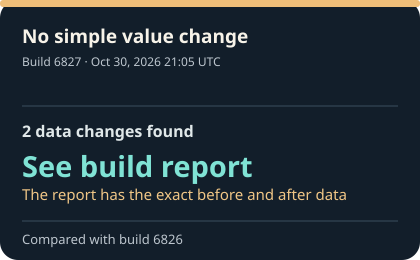
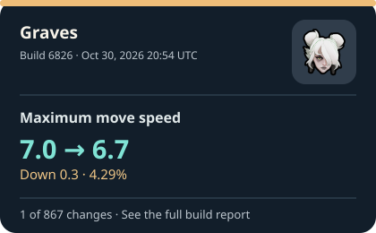
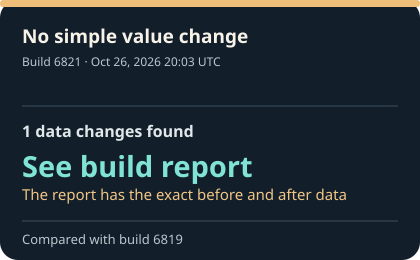
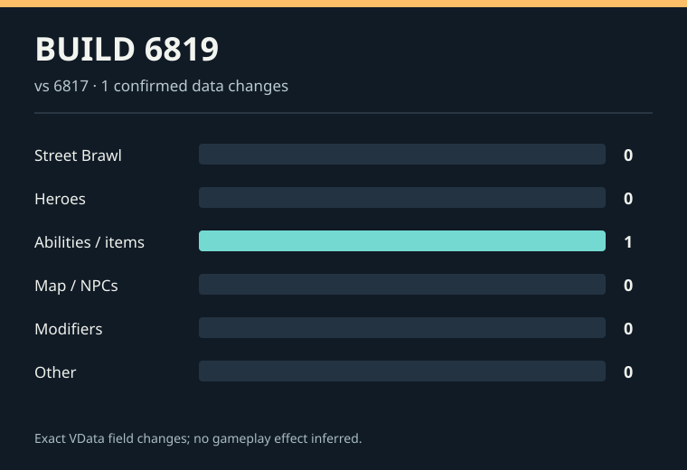
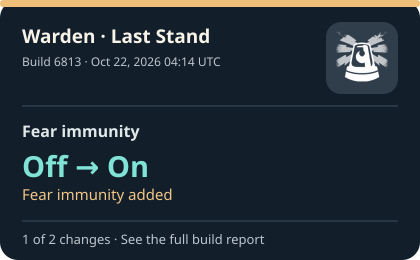

## What changed in Deadlock?

**Latest build recorded:** [6827](builds/6827.md) on Oct 30, 2026 at 21:05 UTC.

**Tracker check:** Scheduled every five minutes. [See the most recent check and its time](https://github.com/jordanbenjaminmitchell/deadlock-tracker/actions/workflows/track.yml). GitHub may start a check late.

**History covered:** Oct 25, 2025–Oct 30, 2026 across 388 saved builds. [Browse by month](index.md#updates-by-month).

### Latest update

This build changed game data, but there is no simple before-and-after value to highlight.

[See everything found in build 6827](builds/6827.md) · [Check the source](https://github.com/SteamTracking/GameTracking-Deadlock/commit/319b4b8a190e78c66bc80d75997ee909433a73d3).

### Previous updates

#### Build 6826 · Oct 30, 2026 20:54 UTC

Graves — Maximum move speed changed from **7.0** to **6.7**.

Key values in this update:

- **Graves — Maximum move speed**: 7.0 → **6.7** (Down 0.3 · 4.29%)
- **Silver — Base health regen**: 2.5 → **3** (Up 0.5 · 20.00%)
- **Solomon — Crit damage bonus scale**: 1.0 → **0.8** (Down 0.2 · 20.00%)
- **Violet · Abstract Landscape — Immune duration**: 0.5 → **0.75** (Up 0.25 · 50.00%)
- **Violet · Still Life — Buildup grace period**: 0.3 → **0.45** (Up 0.15 · 50.00%)

[See all changes in build 6826](builds/6826.md) · [Check the source](https://github.com/SteamTracking/GameTracking-Deadlock/commit/fd21313e755aaac0a1625e0851b8d5c3f03ff46d).

#### Build 6821 · Oct 26, 2026 20:03 UTC

This build changed data without a simple value to highlight.

[See all changes in build 6821](builds/6821.md) · [Check the source](https://github.com/SteamTracking/GameTracking-Deadlock/commit/d251cf9d9a796061c90f58724230b7e17b97121b).

#### Build 6819 · Oct 22, 2026 23:53 UTC

Violet · Living Ink — Minimum stroke distance is now listed as **15.0**. There is no confirmed earlier value.

- **Violet · Living Ink — Minimum stroke distance**: new setting **15.0**

[See all changes in build 6819](builds/6819.md) · [Check the source](https://github.com/SteamTracking/GameTracking-Deadlock/commit/17462b250a0ca80e7f80102f2c83cc3eecff5f12).

#### Build 6813 · Oct 22, 2026 04:14 UTC

Warden · Last Stand — Fear immunity changed from **Off** to **On**.

Key values in this update:

- **Warden · Last Stand — Fear immunity**: Off → **On** (Fear immunity added)
- **Warden · Last Stand — Fear immunity during auto-cast delay**: new setting **On**

[See all changes in build 6813](builds/6813.md) · [Check the source](https://github.com/SteamTracking/GameTracking-Deadlock/commit/a94d8b455203f12b176de75a5598dd8e6e8a94d4).

Last five changes with a verified before and after

These are individual values, so several can come from one build.

- **Graves — Maximum move speed**: 7.0 → **6.7** (Down 0.3 · 4.29%) · Oct 30, 2026 20:54 UTC · Build 6826 ([card](infographics/recent/6826-69584e8a99e9.svg); [full update](builds/6826.md))
- **Silver — Base health regen**: 2.5 → **3** (Up 0.5 · 20.00%) · Oct 30, 2026 20:54 UTC · Build 6826 ([card](infographics/recent/6826-3aa2124330ab.svg); [full update](builds/6826.md))
- **Solomon — Crit damage bonus scale**: 1.0 → **0.8** (Down 0.2 · 20.00%) · Oct 30, 2026 20:54 UTC · Build 6826 ([card](infographics/recent/6826-708b0c701052.svg); [full update](builds/6826.md))
- **Violet · Abstract Landscape — Immune duration**: 0.5 → **0.75** (Up 0.25 · 50.00%) · Oct 30, 2026 20:54 UTC · Build 6826 ([card](infographics/recent/6826-b8fae3106743.svg); [full update](builds/6826.md))
- **Violet · Still Life — Buildup grace period**: 0.3 → **0.45** (Up 0.15 · 50.00%) · Oct 30, 2026 20:54 UTC · Build 6826 ([card](infographics/recent/6826-29d1601b2634.svg); [full update](builds/6826.md))

