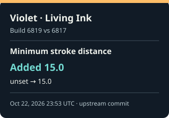
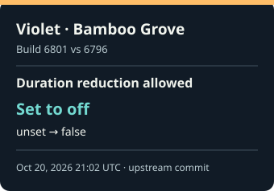
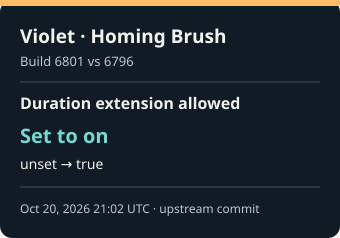

## Latest verified field changes

Five most recent scalar changes in tracked VData. Times are upstream commit timestamps in UTC; changes within one build share a timestamp and are ordered by field path. Values keep their source units; no unit conversion is inferred. Each build report contains its full set of changes.

<table>
<tr>
<td width="20%">

</td>
<td width="20%">

</td>
<td width="20%">

</td>
<td width="20%">

</td>
<td width="20%">

</td>
</tr>
</table>

### Exact changes and times

<ol>
<li><strong>Violet · Living Ink — Minimum stroke distance: Added 15.0</strong> Build 6819 · Oct 22, 2026 23:53 UTC (<a href="builds/6819.md">full report</a>; <a href="https://github.com/SteamTracking/GameTracking-Deadlock/commit/17462b250a0ca80e7f80102f2c83cc3eecff5f12">upstream commit</a>) <code>unset</code> → <code>15.0</code> · Source field: <code>abilities.ability_artist_pullbrush.m_flMinStrokeDistance</code></li>
<li><strong>Warden · Riot Protocol — Auto-cast delay state flags: Fear-immunity flag added</strong> Build 6813 · Oct 22, 2026 04:14 UTC (<a href="builds/6813.md">full report</a>; <a href="https://github.com/SteamTracking/GameTracking-Deadlock/commit/a94d8b455203f12b176de75a5598dd8e6e8a94d4">upstream commit</a>) <code>unset</code> → <code>&quot;MODIFIER_STATE_FEAR_IMMUNE&quot;</code> · Source field: <code>abilities.ability_warden_riot_protocol.m_AutoCastDelayModifier.m_nEnabledStateMask</code></li>
<li><strong>Warden · Riot Protocol — Warden buff state flags: Fear-immunity flag added</strong> Build 6813 · Oct 22, 2026 04:14 UTC (<a href="builds/6813.md">full report</a>; <a href="https://github.com/SteamTracking/GameTracking-Deadlock/commit/a94d8b455203f12b176de75a5598dd8e6e8a94d4">upstream commit</a>) <code>&quot;MODIFIER_STATE_SINCLAIR_TAX_ULT_ACTIVE | MODIFIER_STATE_SINCLAIR_TAX_KEEP_MODEL_SWAP&quot;</code> → <code>&quot;MODIFIER_STATE_SINCLAIR_TAX_ULT_ACTIVE | MODIFIER_STATE_SINCLAIR_TAX_KEEP_MODEL_SWAP | MODIFIER_STATE_FEAR_IMMUNE&quot;</code> · Source field: <code>abilities.ability_warden_riot_protocol.m_WardenBuffModifier.m_nEnabledStateMask</code></li>
<li><strong>Violet · Bamboo Grove — Duration reduction allowed: Set to off</strong> Build 6801 · Oct 20, 2026 21:02 UTC (<a href="builds/6801.md">full report</a>; <a href="https://github.com/SteamTracking/GameTracking-Deadlock/commit/37f9aebdc62766aa13748f73309b9b8120549833">upstream commit</a>) <code>unset</code> → <code>false</code> · Source field: <code>abilities.ability_artist_bamboogrove.m_BambooModifier.m_ImmuneModifier.m_bDurationReducible</code></li>
<li><strong>Violet · Homing Brush — Duration extension allowed: Set to on</strong> Build 6801 · Oct 20, 2026 21:02 UTC (<a href="builds/6801.md">full report</a>; <a href="https://github.com/SteamTracking/GameTracking-Deadlock/commit/37f9aebdc62766aa13748f73309b9b8120549833">upstream commit</a>) <code>unset</code> → <code>true</code> · Source field: <code>abilities.ability_artist_homingbrush.m_StackModifier.m_bDurationExtendible</code></li>
</ol>
