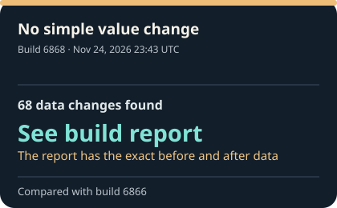
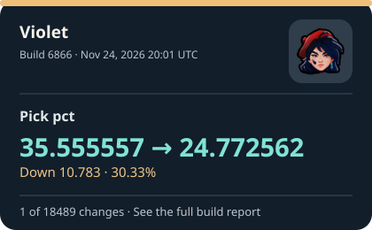
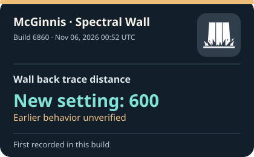

## What changed in Deadlock?

**Latest build recorded:** [6875](builds/6875.md) on Nov 27, 2026 at 06:41 UTC.

**Tracker check:** Scheduled every five minutes. [See the most recent check and its time](https://github.com/jordanbenjaminmitchell/deadlock-tracker/actions/workflows/track.yml). GitHub may start a check late.

**History covered:** Oct 25, 2025–Nov 27, 2026 across 418 saved builds. [Browse by month](index.md#updates-by-month).

### Latest update

This build changed game data, but there is no simple before-and-after value to highlight.

[See everything found in build 6875](builds/6875.md) · [Check the source](https://github.com/SteamTracking/GameTracking-Deadlock/commit/6d9ccf2531f8b097e7b97908765eda6f1b501de1).

### Previous updates

#### Build 6871 · Nov 26, 2026 17:24 UTC

Violet — Maximum health changed from **710.0** to **650.0**.

Key values in this update:

- **Violet — Maximum health**: 710.0 → **650.0** (Down 60 · 8.45%)
- **Holliday — Maximum health**: 780.0 → **715.0** (Down 65 · 8.33%)
- **Abrams — Maximum health**: 800.0 → **735.0** (Down 65 · 8.12%)
- **Baba — Maximum health**: 780.0 → **715.0** (Down 65 · 8.33%)
- **Base — Maximum health**: 780.0 → **715.0** (Down 65 · 8.33%)

[See all changes in build 6871](builds/6871.md) · [Check the source](https://github.com/SteamTracking/GameTracking-Deadlock/commit/77b862290ad3050cafd2e9c3f47e0532e9d6dcfd).

#### Build 6868 · Nov 24, 2026 23:43 UTC

This build changed data without a simple value to highlight.

[See all changes in build 6868](builds/6868.md) · [Check the source](https://github.com/SteamTracking/GameTracking-Deadlock/commit/e835dad025d2d4ec7ef126aa13863d1df25d726d).

#### Build 6866 · Nov 24, 2026 20:01 UTC

Violet — Pick pct changed from **35.555557** to **24.772562**.

Key values in this update:

- **Violet — Pick pct**: 35.555557 → **24.772562** (Down 10.783 · 30.33%)
- **Violet — Winrate pct**: 43.75 → **47.15085** (Up 3.40085 · 7.77%)
- **Violet — Pick pct**: 86.666664 → **73.34479** (Down 13.3219 · 15.37%)
- **Violet — Winrate pct**: 46.153847 → **47.932564** (Up 1.77872 · 3.85%)
- **Violet — Pick pct**: 40.0 → **13.717844** (Down 26.2822 · 65.71%)

[See all changes in build 6866](builds/6866.md) · [Check the source](https://github.com/SteamTracking/GameTracking-Deadlock/commit/dca492d664e77bdef97eeb80bbcbf0b749df651a).

#### Build 6860 · Nov 06, 2026 00:52 UTC

McGinnis · Spectral Wall — Wall back trace distance is now listed as **600**. There is no confirmed earlier value.

- **McGinnis · Spectral Wall — Wall back trace distance**: new setting **600**

[See all changes in build 6860](builds/6860.md) · [Check the source](https://github.com/SteamTracking/GameTracking-Deadlock/commit/3cfcaf9ed882f2d85cc5d915315f754790b8ffb7).

Last five changes with a verified before and after

These are individual values, so several can come from one build.

- **Violet — Maximum health**: 710.0 → **650.0** (Down 60 · 8.45%) · Nov 26, 2026 17:24 UTC · Build 6871 ([card](infographics/recent/6871-eaa34a796d39.svg); [full update](builds/6871.md))
- **Holliday — Maximum health**: 780.0 → **715.0** (Down 65 · 8.33%) · Nov 26, 2026 17:24 UTC · Build 6871 ([card](infographics/recent/6871-7a6df84574a2.svg); [full update](builds/6871.md))
- **Abrams — Maximum health**: 800.0 → **735.0** (Down 65 · 8.12%) · Nov 26, 2026 17:24 UTC · Build 6871 ([card](infographics/recent/6871-7c36307d736e.svg); [full update](builds/6871.md))
- **Baba — Maximum health**: 780.0 → **715.0** (Down 65 · 8.33%) · Nov 26, 2026 17:24 UTC · Build 6871 ([card](infographics/recent/6871-83eb231f7d53.svg); [full update](builds/6871.md))
- **Base — Maximum health**: 780.0 → **715.0** (Down 65 · 8.33%) · Nov 26, 2026 17:24 UTC · Build 6871 ([card](infographics/recent/6871-ce650b650f02.svg); [full update](builds/6871.md))

