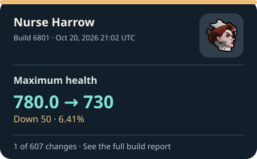
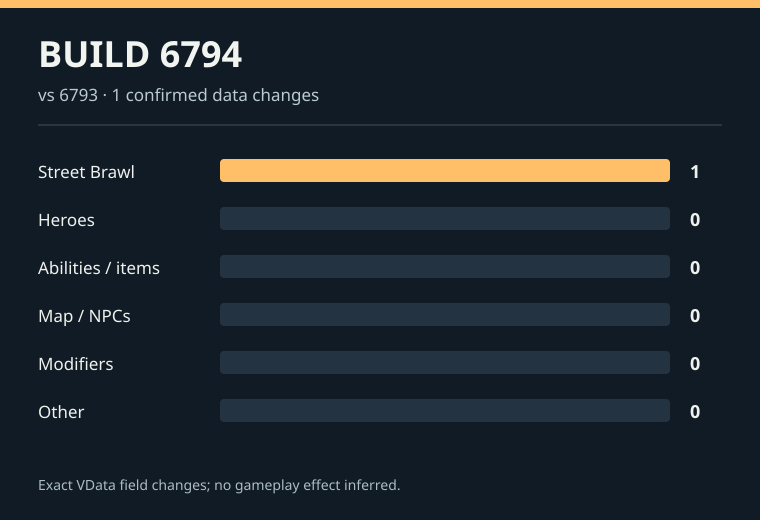

## What changed in Deadlock?

**Latest build recorded:** [6819](builds/6819.md) on Oct 22, 2026 at 23:53 UTC.

**Tracker check:** Scheduled every five minutes. [See the most recent check and its time](https://github.com/jordanbenjaminmitchell/deadlock-tracker/actions/workflows/track.yml). GitHub may start a check late.

### Latest update

Violet · Living Ink — Minimum stroke distance is now listed as **15.0**. There is no confirmed earlier value.

[See everything found in build 6819](builds/6819.md).

### Earlier updates with changes in the files we follow

Each build gets one card. The key numbers sit below it, with the previous and new value shown when both are known.

#### Build 6813 · Oct 22, 2026 04:14 UTC

Warden · Last Stand — Fear immunity changed from **Off** to **On**.

Key values in this update:

- **Warden · Last Stand — Fear immunity**: Off → **On** (Fear immunity added)
- **Warden · Last Stand — Fear immunity during auto-cast delay**: new setting **On**

[See all changes in build 6813](builds/6813.md).

#### Build 6801 · Oct 20, 2026 21:02 UTC

Nurse Harrow changed from **Pre-release** to **Released** in the game data.

Key values in this update:

- **Nurse Harrow — Release status**: Pre-release → **Released**
- **Nurse Harrow — Maximum health**: 780.0 → **730** (Down 50 · 6.41%)
- **Nurse Harrow — Sprint speed**: 1.6 → **2.5** (Up 0.9 · 56.25%)
- **Nurse Harrow — Maximum move speed**: 7.2 → **6.8** (Down 0.4 · 5.56%)
- **Nurse Harrow — Base health regen**: 2.0 → **0** (Down 2 · 100.00%)

[See all changes in build 6801](builds/6801.md).

#### Build 6794 · Oct 17, 2026 21:32 UTC

Street Brawl — Buy time, fifth value changed from **65** to **50**.

- **Street Brawl — Buy time, fifth value**: 65 → **50** (Down 15 · 23.08%)

[See all changes in build 6794](builds/6794.md).

Last five changes with a verified before and after

These are individual values, so several can come from one build.

- **Warden · Last Stand — Fear immunity**: Off → **On** (Fear immunity added) · Build 6813 ([card](infographics/recent/6813-1cd069c8b4a2.svg); [full update](builds/6813.md))
- **Nurse Harrow — Release status**: Pre-release → **Released** · Build 6801 ([card](infographics/recent/6801-2de523031bd0.svg); [full update](builds/6801.md))
- **Nurse Harrow — Maximum health**: 780.0 → **730** (Down 50 · 6.41%) · Build 6801 ([card](infographics/recent/6801-a4483b1c959f.svg); [full update](builds/6801.md))
- **Nurse Harrow — Sprint speed**: 1.6 → **2.5** (Up 0.9 · 56.25%) · Build 6801 ([card](infographics/recent/6801-d6f27d6154ce.svg); [full update](builds/6801.md))
- **Nurse Harrow — Maximum move speed**: 7.2 → **6.8** (Down 0.4 · 5.56%) · Build 6801 ([card](infographics/recent/6801-8039798a3b0c.svg); [full update](builds/6801.md))

