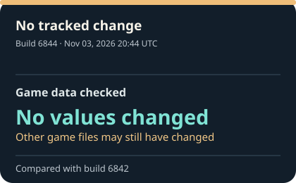
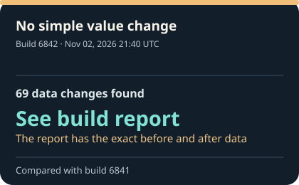
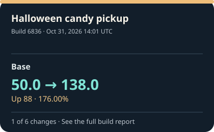
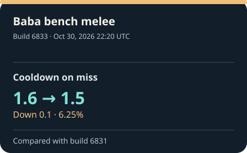
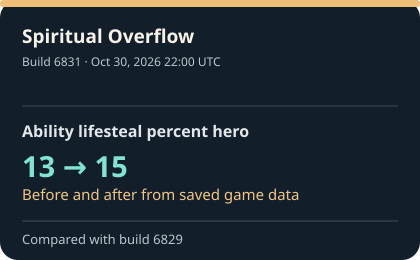
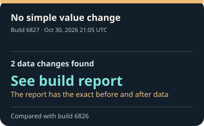

## What changed in Deadlock?

**Latest build recorded:** [6844](builds/6844.md) on Nov 03, 2026 at 20:44 UTC.

**Tracker check:** Scheduled every five minutes. [See the most recent check and its time](https://github.com/jordanbenjaminmitchell/deadlock-tracker/actions/workflows/track.yml). GitHub may start a check late.

**History covered:** Oct 25, 2025–Nov 03, 2026 across 399 saved builds. [Browse by month](index.md#updates-by-month).

### Latest update

No value changed in the game data this tracker watches.

[See everything found in build 6844](builds/6844.md) · [Check the source](https://github.com/SteamTracking/GameTracking-Deadlock/commit/55b2f6b152cb0970fb03b9e591cc1697909ce2e3).

### Previous updates

#### Build 6842 · Nov 02, 2026 21:40 UTC

This build changed data without a simple value to highlight.

[See all changes in build 6842](builds/6842.md) · [Check the source](https://github.com/SteamTracking/GameTracking-Deadlock/commit/fc53d8b267db6949b03d3fdb975dff4c9028f77b).

#### Build 6836 · Oct 31, 2026 14:01 UTC

Halloween candy pickup — Base changed from **50.0** to **138.0**.

Key values in this update:

- **Halloween candy pickup — Base**: 50.0 → **138.0** (Up 88 · 176.00%)
- **Halloween candy pickup — Collection method**: new setting **VacuumTrigger**

[See all changes in build 6836](builds/6836.md) · [Check the source](https://github.com/SteamTracking/GameTracking-Deadlock/commit/054a283124561dedd79df03fe82fcf5d99806680).

#### Build 6833 · Oct 30, 2026 22:20 UTC

Baba bench melee — Cooldown on miss changed from **1.6** to **1.5**.

- **Baba bench melee — Cooldown on miss**: 1.6 → **1.5** (Down 0.1 · 6.25%)

[See all changes in build 6833](builds/6833.md) · [Check the source](https://github.com/SteamTracking/GameTracking-Deadlock/commit/b18c406df07927fc6041d5d010241e7e88b8323b).

#### Build 6831 · Oct 30, 2026 22:00 UTC

Spiritual Overflow — Ability lifesteal percent hero changed from **13** to **15**.

- **Spiritual Overflow — Ability lifesteal percent hero**: 13 → **15**

[See all changes in build 6831](builds/6831.md) · [Check the source](https://github.com/SteamTracking/GameTracking-Deadlock/commit/f6be4e77c8be192a904a22de58adf3e66a26104f).

#### Build 6827 · Oct 30, 2026 21:05 UTC

This build changed data without a simple value to highlight.

[See all changes in build 6827](builds/6827.md) · [Check the source](https://github.com/SteamTracking/GameTracking-Deadlock/commit/319b4b8a190e78c66bc80d75997ee909433a73d3).

Last five changes with a verified before and after

These are individual values, so several can come from one build.

- **Halloween candy pickup — Base**: 50.0 → **138.0** (Up 88 · 176.00%) · Oct 31, 2026 14:01 UTC · Build 6836 ([card](infographics/recent/6836-00dc0bce3ccd.svg); [full update](builds/6836.md))
- **Baba bench melee — Cooldown on miss**: 1.6 → **1.5** (Down 0.1 · 6.25%) · Oct 30, 2026 22:20 UTC · Build 6833 ([card](infographics/recent/6833-92649cebfee9.svg); [full update](builds/6833.md))
- **Spiritual Overflow — Ability lifesteal percent hero**: 13 → **15** · Oct 30, 2026 22:00 UTC · Build 6831 ([card](infographics/recent/6831-7cc198ac25c7.svg); [full update](builds/6831.md))
- **Graves — Maximum move speed**: 7.0 → **6.7** (Down 0.3 · 4.29%) · Oct 30, 2026 20:54 UTC · Build 6826 ([card](infographics/recent/6826-69584e8a99e9.svg); [full update](builds/6826.md))
- **Silver — Base health regen**: 2.5 → **3** (Up 0.5 · 20.00%) · Oct 30, 2026 20:54 UTC · Build 6826 ([card](infographics/recent/6826-3aa2124330ab.svg); [full update](builds/6826.md))

